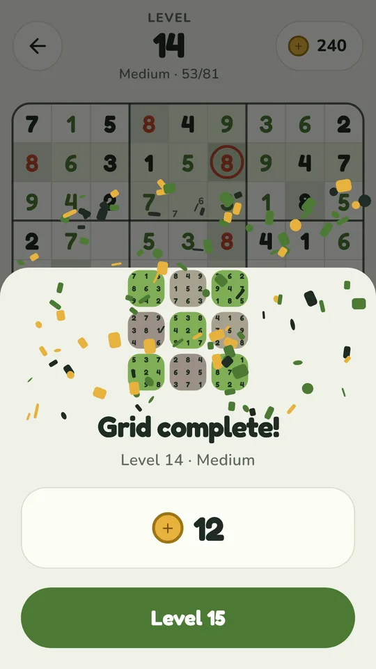
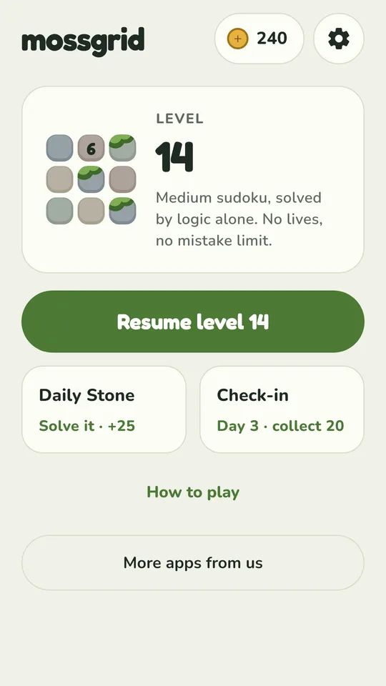

# Mossgrid: Sudoku Puzzles

A free classic sudoku game for Android on a calm board of moss and river stones. Fill every row, column and 3×3 box with 1 to 9. Every puzzle has exactly one solution you can reach by logic alone, with no lives, no mistake limit and no ads during a puzzle.

<a href="https://play.google.com/store/apps/details?id=com.nktools.mossgrid&utm_source=github&utm_medium=readme"><b>Get it on Google Play</b></a> · <a href="https://mossgrid.pages.dev/">Website</a> · <a href="https://nookeshkarri7.github.io/mossgrid-sudoku/">About page</a>

## How it plays

- **Tap a cell, tap a digit.** The row, column, box and matching digits light up.
- **Pencil notes.** Turn on Notes to jot candidates; placing a digit clears it from the notes around it.
- **Logic only.** Every puzzle is checked by a solver that only makes forced moves, so it has one solution and never needs a guess.
- **No lives, no mistake limit.** Repeated digits glow red; Check rings wrong digits when you ask; undo is always free.
- **Hints that teach.** A hint fixes a mistake first, otherwise it fills the next cell logic finds.
- **Easy to Expert.** Levels get harder as you go, plus a Daily Stone puzzle for everyone.
- **Plays offline.** No Wi-Fi, no account. Light and dark themes.

Free, no purchases. Supported by optional videos and an occasional ad between puzzles, never during one.

## Links

- Google Play: https://play.google.com/store/apps/details?id=com.nktools.mossgrid
- Website: https://mossgrid.pages.dev/
- Privacy policy: https://mossgrid.pages.dev/privacy/
- Teaser: https://youtu.be/seeZQp4nWQM

© 2026 NK Tools
